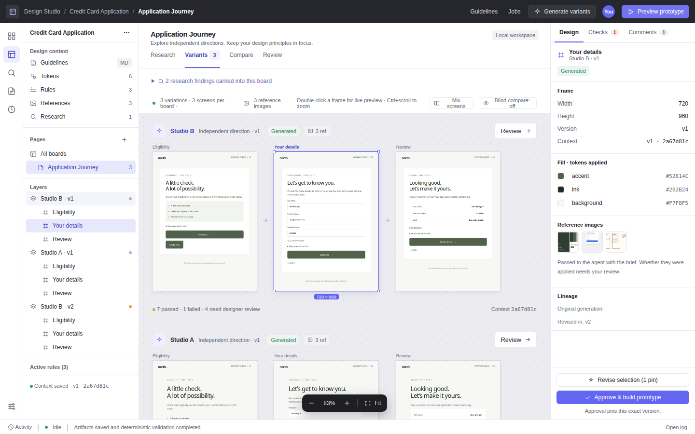
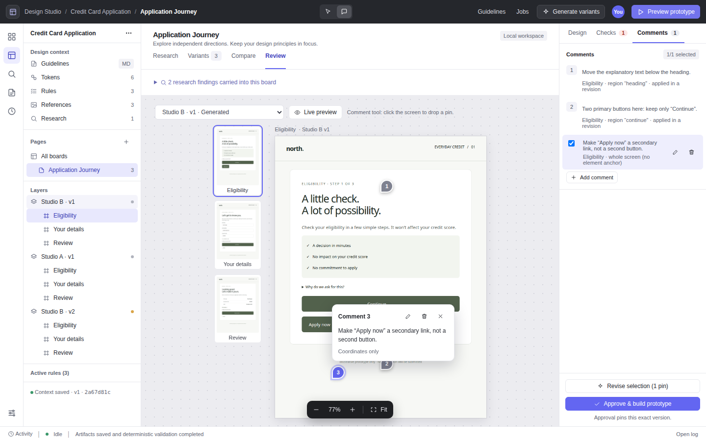
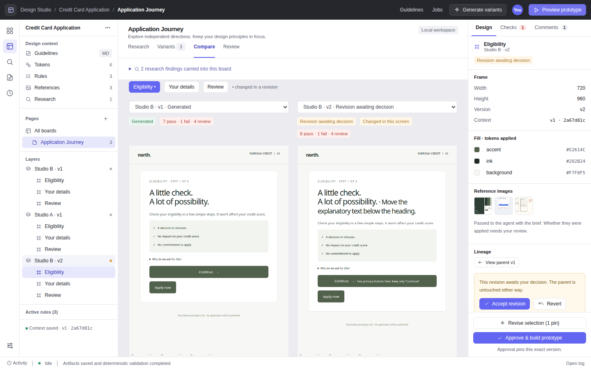
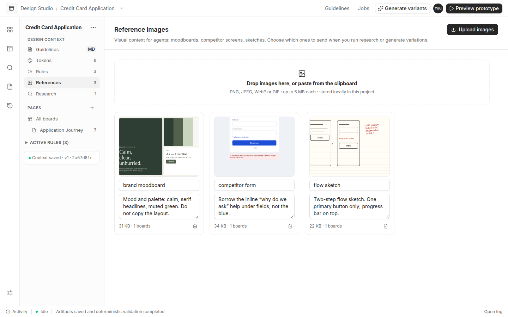
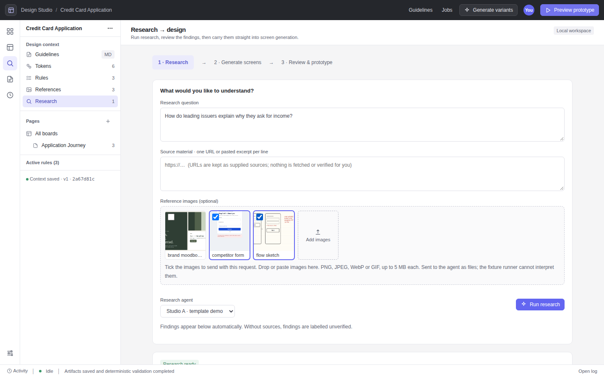
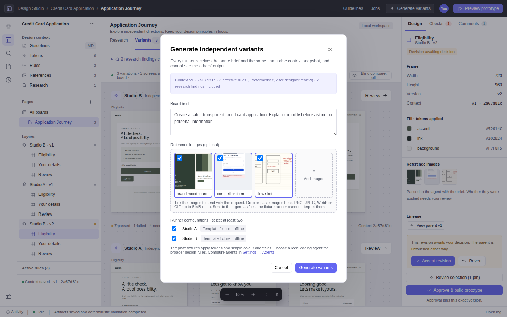

# Design Studio

A local, single-user design workbench with persistent guidance, research, independent screen boards, visual feedback and static click-through export.

## Run

Requirements: Python 3.10+; Google Chrome on PATH as `google-chrome` for rendered screenshot previews. Coding-agent CLIs are optional and use their existing local authentication.

```sh
python3 apps/api/server.py
```

Open http://localhost:5173. No package installation or API key is required for fixture mode. SQLite and generated artifacts are stored in `storage/`. Configure `PORT` and `STUDIO_STORAGE` through environment variables if needed.

If startup reports that the port is already in use, choose another port:

```sh
PORT=5174 python3 apps/api/server.py
```

Open the URL printed after the server successfully starts.

## Screenshots

| | |
|---|---|
|  |  |
|  |  |
|  |  |

More in [docs/screenshots](docs/screenshots). Regenerate them with `tests/snapshots.mjs` (fixture runners only).

## Workflow

See [docs/USER_GUIDE.md](docs/USER_GUIDE.md) for the full walkthrough. In short:

1. **References** – upload moodboards, competitor screens or sketches (PNG/JPEG/WebP/GIF, 5 MB each) and add a note for the agent. Tick which ones to send with research and with generation. Each job keeps its own copy, listed in the task text under `references/`.
2. **Guidelines** – edit `DESIGN.md` (live preview), tokens (table and swatches) and rules (stable IDs, per-rule versions). Save a version; identical saves do not create new versions. Every job snapshots the saved version and its SHA-256.
3. **Research** – ask a question, optionally add URLs or pasted excerpts (kept as *supplied*, never verified for you). Use all or selected findings to create a new board, or attach them to an existing board.
4. **Generate** – pick two or more runners (fixtures by default, so no API key is needed). Failed, timed-out or cancelled runs get a card with **Retry** (same inputs); other variations stay usable.
5. **Compare** – choose any two versions side by side, including a parent and its revision.
6. **Review** – click a screen to pin feedback (anchored to a `data-design-id` element where possible), edit or delete pins, tick which pins to use, then **Revise selection**. A revision is a new child version that you **Accept** or **Revert**; the parent is never modified.
7. **Checks** – deterministic results are shown separately from items that need your judgement; mark each review item OK or needs-change.
8. **Approve & build prototype** – approval pins and locks the version, builds an immutable bundle and opens the player (back/forward, Default/Help/Error states, 1440/390 device framing, new tab, ZIP export).
9. **History** – lineage from context to prototype, job inputs/outputs and logs.

## Checking a real agent (contract doctor)

```sh
python3 apps/api/doctor.py claude --guidance --references --region --mix     # or: codex
```

Runs the agent through the studio's own runner path on a throwaway project (temporary storage; your projects are untouched) and reports each stage: manifest and package validation, screenshots, whether changing a token changes the output (`--guidance`) and whether the agent really read a reference image (`--references`), whether a pinned-element revision changes only that element (`--region`) and whether mixed versions render identically to their sources (`--mix`). It uses your own agent login and makes 1–6 real model calls depending on flags (several minutes). Add `--keep` to inspect the generated files.

## Verification

```sh
python3 -m unittest discover -s tests -v
for f in apps/web/*.js; do node --input-type=module --check < "$f"; done
node --test tests/research.test.mjs
```

Browser workflow (needs Node, Playwright and Chrome; use a disposable storage directory; fixture runners only):

```sh
npm install --no-save @playwright/test
STUDIO_STORAGE=$(mktemp -d) PORT=5199 python3 apps/api/server.py &
STUDIO_URL=http://localhost:5199 node tests/browser.mjs
STUDIO_URL=http://localhost:5199 node tests/snapshots.mjs   # regenerate docs/screenshots
```

See [Known limitations](KNOWN_LIMITATIONS.md), [decisions](docs/DECISIONS.md) and [runner contract](docs/RUNNER_CONTRACT.md). This is an initial implementation; the full specification acceptance checklist is not yet certified.
