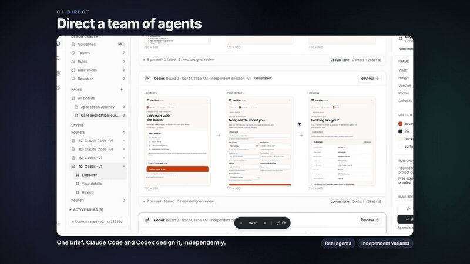
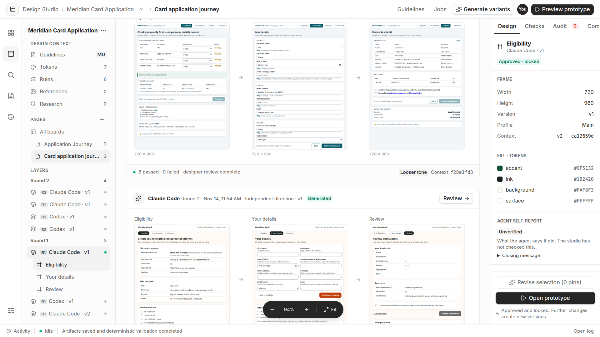
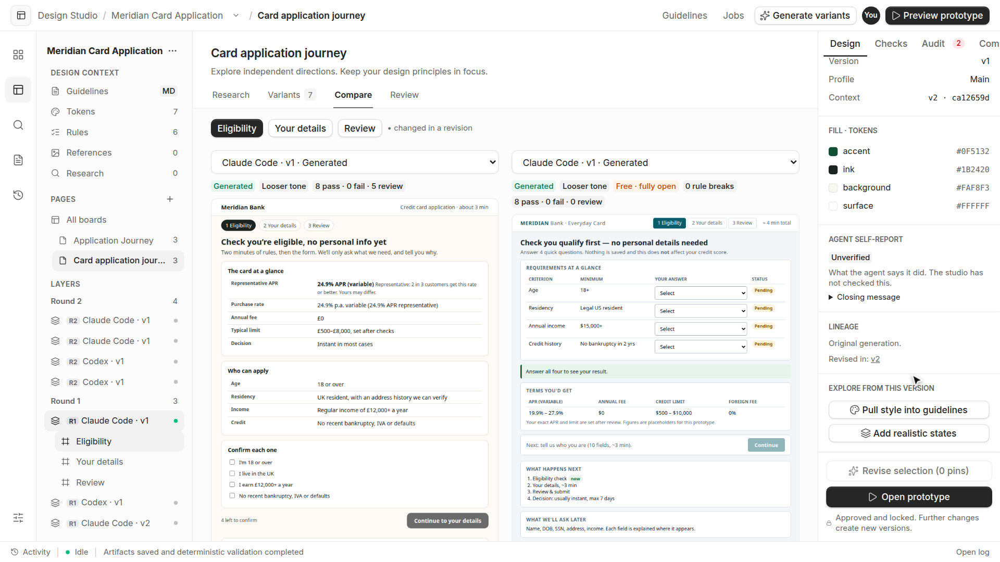
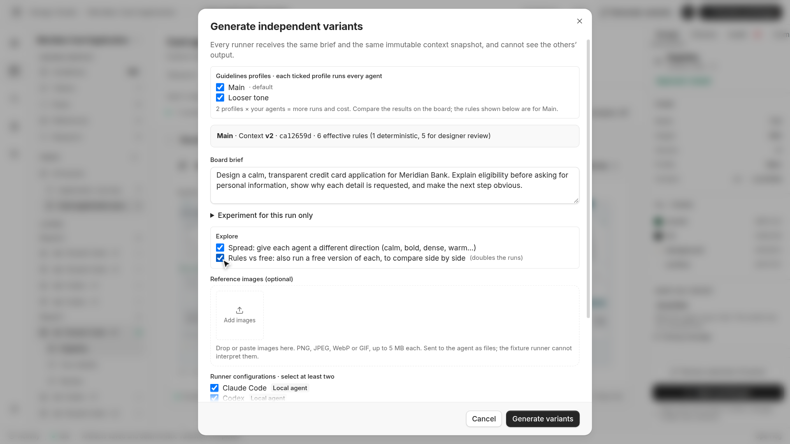
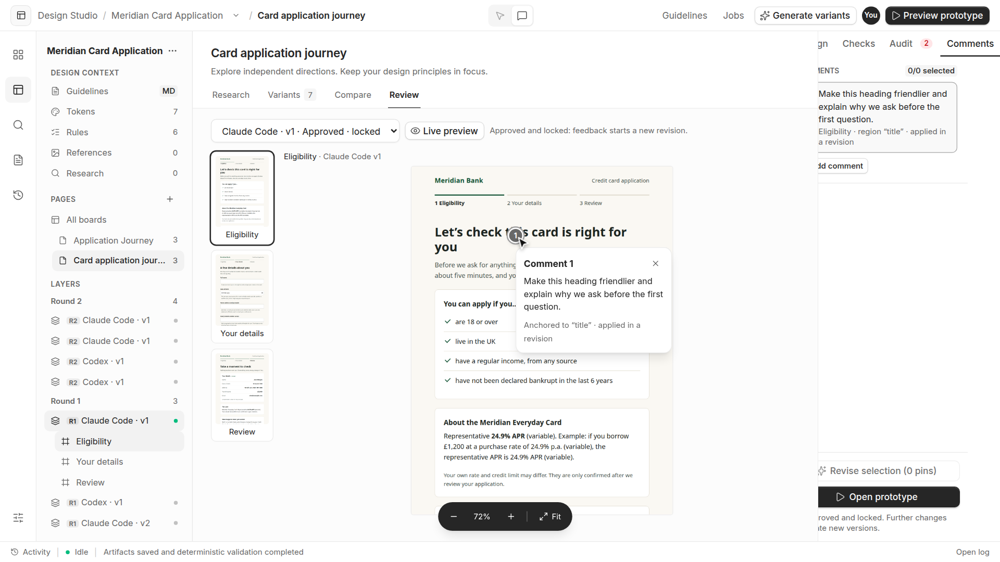
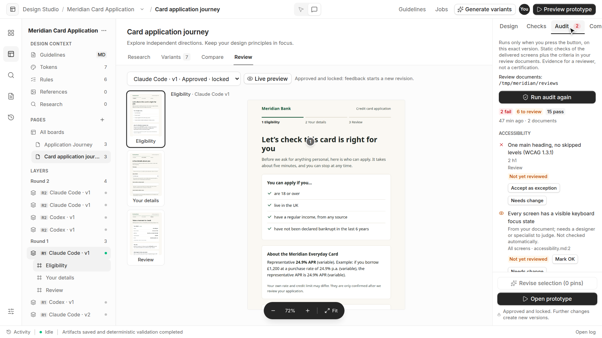
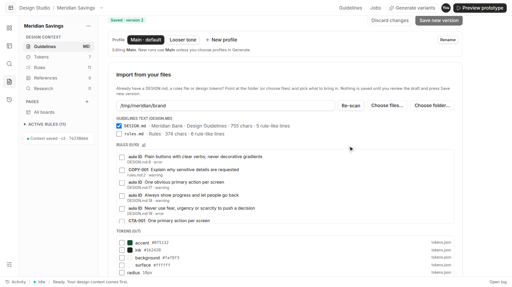
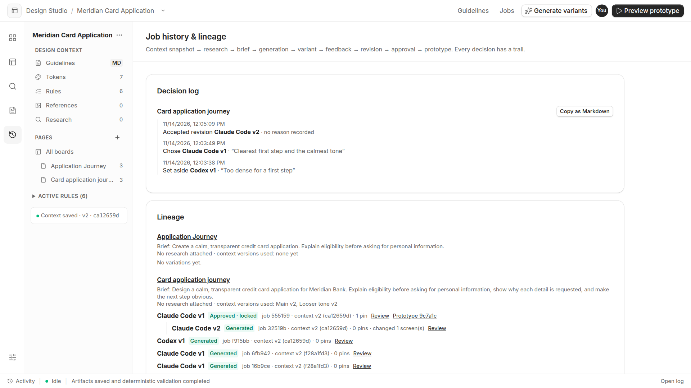
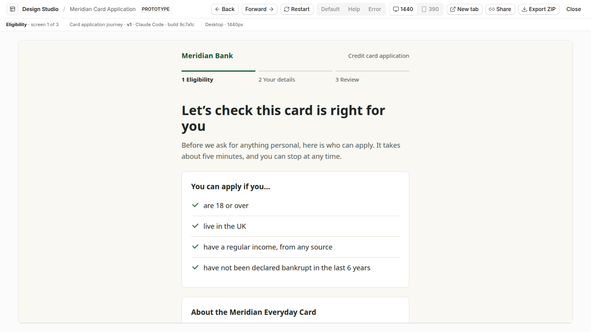
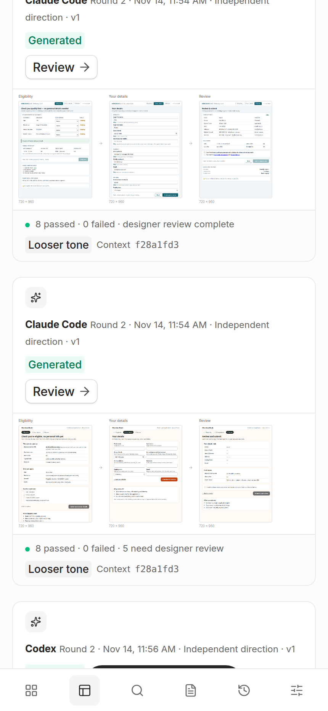

<div align="center">

# Design Studio

**Direct AI coding agents like a design team, and keep the judgment.**

A local, single-user workbench where designers brief Claude Code and Codex, compare what each one makes, test different rules, review with pins, audit against their own documents, and decide with a paper trail.

[](https://github.com/meabs/Designstudio/actions/workflows/ci.yml)


<br />

[](https://github.com/meabs/Designstudio/releases/download/v0.1.0/design-studio-tour-landscape.mp4)

**[▶ Watch the 100-second tour](https://github.com/meabs/Designstudio/releases/download/v0.1.0/design-studio-tour-landscape.mp4)** · [portrait version for social](https://github.com/meabs/Designstudio/releases/download/v0.1.0/design-studio-tour-portrait.mp4)

<sub>Everything in the video is the real app, recorded against real Claude Code and Codex runs.</sub>

</div>

---

## Contents

[Why](#why) · [Highlights](#highlights) · [Screenshots](#screenshots) · [Quick start](#quick-start) · [How it works](#how-it-works) · [Working with agents](#working-with-agents) · [Operating it](#operating-it) · [Security model](#security-model) · [Architecture](#architecture) · [Development](#development) · [Status and limitations](#status-and-limitations)

## Why

Coding agents can produce a whole interface in a minute. What they do not give a designer is **control and evidence**: which rules were in force, what each agent actually did, how two directions compare, and why one was chosen.

Design Studio puts that around the agents. Every run is a job with an **immutable snapshot** of the guidelines it was given. Agents work independently, cannot see each other's output, and their results are validated, compared and reviewed in one place. It runs on your machine, uses the agents you already have logged in, and needs no Docker, no database server and no sign-up.

## Highlights

| | |
|---|---|
| **Independent variants** | One brief goes to several agents (Claude Code, Codex, or built-in template runners). Each gets the same inputs and snapshot and cannot see the others. Optional blind A/B hides which agent made what. |
| **Faster to a result** | Spread is on by default so agents differ; draft guidelines from a short description; bring one part of another design into yours; ask a question about a pin without changing anything; a run that times out after finishing is kept as **Cut off**; a **developer hand-off** zip (site plus guidelines, tokens, rules). |
| **Experiment freely** | **Spread** gives each agent a different direction. **Free exploration** drops the rules and checks for a run. **Rules vs free** runs everything twice for a side-by-side, and a **rule-break log** shows what the rules would have said. |
| **Guideline profiles** | Keep several named, separately versioned sets of `DESIGN.md`, rules and tokens per project, and run every agent under each to compare. |
| **Bring your own files** | Import `DESIGN.md`, rules files and token files (JSON or CSS variables) from a folder or the browser. Review the draft, then save a version. No pasting. |
| **Live visibility** | Watch each agent's progress, screens written, elapsed time and usage while it runs, with a time and cost estimate before you start. |
| **Edit directly** | The **Edit** tool (E) puts the live screen in the review canvas. Click any element, change its text, colours, type, radius, padding, opacity or visibility (project tokens offered as swatches), then save as a new child version. No agent run, the parent is never modified, and checks, region diff and accept/revert apply as for any revision. |
| **Pin, don't prompt** | Pin feedback on a screen element. Revisions can be limited to the pinned region, and the studio checks that nothing else changed. A revision is a new child version you accept or revert. |
| **Audit on demand** | A manual audit runs accessibility checks (WCAG-referenced) plus checklists from **your own Markdown documents** (legal, design review). An optional agent reading of those documents is always labelled unverified. |
| **Decide with a trail** | Approve or set aside with a reason, share the decision log as Markdown, and build an immutable, clickable prototype with a read-only share link. |
| **Pull style back** | Extract colours, fonts and radii from a good variant straight into the guidelines. Add realistic empty, loading, error and long-content states to any version. |
| **Websites and mobile apps** | Choose per board: a desktop website (1440 wide), a mobile app (390×844 phone) or one responsive design checked at both. Agents are briefed for the target, screenshots and pins follow it, and boards hold up to 12 screens. |
| **Works on your phone** | Opt in to LAN mode and review from a phone on the same Wi-Fi. |

## Screenshots

| | |
|---|---|
| <br /><sub>**Board.** Rounds of independent variants, each tagged with agent and guideline profile.</sub> | <br /><sub>**Rules vs free.** The same idea with and without the rules, side by side.</sub> |
| <br /><sub>**Experiment.** Profiles, spread directions and rules-vs-free in one dialog.</sub> | <br /><sub>**Review.** Pin feedback to an element; revise only that region.</sub> |
| <br /><sub>**Audit.** Accessibility checks and your own documents, run when you decide.</sub> | <br /><sub>**Import.** Bring existing DESIGN.md, rules and tokens; review before saving.</sub> |
| <br /><sub>**Decision log.** Every approval and set-aside with its reason.</sub> | <br /><sub>**Prototype.** An approved version becomes a clickable bundle.</sub> |

<p align="center"><br /><sub>The same studio on a phone over Wi-Fi.</sub></p>

## Quick start

**Requirements:** Python 3.10+. Node 20+ and npm **once**, to build the UI (`make run` does it the first time). Google Chrome on `PATH` as `google-chrome` for rendered screenshot previews. Coding-agent CLIs (Claude Code, Codex) are optional and use their own existing login.

```sh
git clone https://github.com/meabs/Designstudio.git
cd Designstudio
make run        # builds the UI on first run, then starts the server
```

Open <http://localhost:5173>. On first start the studio adds any installed **Claude Code** and **Codex** as runners; add others, or change models, under **Settings → Agents & models**. Without an agent installed there is nothing to generate with (set `STUDIO_SEED_FIXTURES=1` for offline template runners). Data lives in `storage/` (SQLite plus generated files).

**Single-file build (no Python or Node needed to run it):** `./packaging/build.sh` produces `dist/designstudio` for the platform you build on (PyInstaller cannot cross-compile). Running it starts the studio and opens your browser; data is kept in `~/.local/share/designstudio` (or the macOS/Windows equivalent). Chrome and your agent CLIs are still needed on the machine. Only the Linux build has been tested.

Port in use? `PORT=5174 python3 apps/api/server.py`.

## How it works

```
 References ─┐
 Guidelines ─┼─►  immutable snapshot ──►  runner A ─┐
 (profile)   │    (DESIGN.md + rules      runner B ─┼─► variants ─► compare ─► review & pin ─► revise
 Research ───┘     + tokens + hash)       runner C ─┘        │                                   │
                                                             ▼                                   ▼
                                                      checks & audit ───────────► approve (reason) ─► prototype ─► share
```

1. **Set up guidelines.** Edit or import `DESIGN.md`, tokens and rules; save a version. Create **profiles** to test alternatives.
2. **Brief and generate.** Pick two or more runners, optionally spread directions, rules-vs-free, or several profiles. See the estimate, then watch live progress.
3. **Compare and review.** Put any two versions side by side. Pin feedback and revise; accept or revert each revision (the parent is never modified).
4. **Check and audit.** Deterministic checks are shown separately from items needing your judgement. Run the audit on the version you are about to ship.
5. **Decide and ship.** Approve with a reason, build the prototype, share it read-only.

The full walkthrough is in the **[User guide](docs/USER_GUIDE.md)**.

## Working with agents

| Runner | Notes |
|---|---|
| **Template (fixture)** | Offline and deterministic **sample output**: generic screens that use your screen names, show your brief as a lead paragraph, and apply your tokens and simple colour directives. It does not interpret the brief and says so on every screen. For tests and trying the workflow; use a coding agent for real design. |
| **Claude Code, Codex** | Local CLIs through their existing authentication. Run inside a **bubblewrap filesystem sandbox** when available, with an environment allow-list. Each run has a timeout, automatic retry options and a full runner log. |

Agent output is untrusted: it is limited to an allow-list of file types, validated against the [runner contract](docs/RUNNER_CONTRACT.md), and its self-report is shown but never presented as verified.

Check that a real agent honours the contract end to end on a throwaway project (makes real model calls with your login):

```sh
python3 apps/api/doctor.py claude --guidance --references --region --mix   # or: codex
```

## Operating it

| Need | How |
|---|---|
| Start / stop | `make run`; Ctrl-C or `SIGTERM` stops workers cleanly. Jobs that were running are marked failed on the next start and can be retried; queued jobs resume. |
| Phone / other devices | `make run-lan`, then open the `http://<your-ip>:5173` address it prints, on the same Wi-Fi. **There is no login**: anyone on that network can use the studio and spend your agent credits, so use it only on a network you trust. Other devices cannot change runners or read folders. |
| Health | `GET /api/health`: uptime, workers, queue depth, job counts, free disk, sandbox availability. |
| Logs | stderr and `storage/studio.log` (rotating). No prompts, request bodies or agent output are logged. |
| Backup | `make backup` (online SQLite backup plus files, safe while running). Restore by pointing `STUDIO_STORAGE` at the backup. |
| Configuration | `PORT`, `STUDIO_HOST`, `STUDIO_STORAGE`, `STUDIO_MAX_JOBS`, `STUDIO_SHARE_PORT`, `STUDIO_SHARE_HOST`, `STUDIO_ALLOWED_HOSTS`, `STUDIO_FOLDER_ROOTS`, `STUDIO_LOG_LEVEL`. |
| Share links | `STUDIO_SHARE_PORT=5180` serves read-only prototype links on a separate listener (loopback unless `STUDIO_SHARE_HOST` is set). |

## Security model

Design Studio is a **single-user local tool**, not a multi-user service.

- Binds to `127.0.0.1` and rejects any `Host` that is not a loopback name (DNS-rebinding guard), because the studio can launch local agents. LAN mode is opt-in and widens this only to this computer's own address and `.local` name (plus `STUDIO_ALLOWED_HOSTS`).
- JSON-only POSTs; unexpected errors return a request id and log details server-side.
- Runner administration and folder reads are allowed only from the computer running the studio. Runners are never created from an executable supplied over the API: coding agents come only from the installed-agent scan, and template runners carry no command.
- Folder reads (guideline import, review documents) are limited to an allowlist, your home folder by default (add more with `STUDIO_FOLDER_ROOTS`, separated by `:`). Symlinks are resolved first, hidden directories such as `.ssh` are refused, and only `.md`, `.json` and `.css` files are read.
- Headless Chrome (screenshots) runs in its own process group and is killed, with its profile removed, if it hangs.
- Agents run in a filesystem sandbox with an environment allow-list; generated screens are shown in sandboxed iframes.
- Do not expose the port beyond your machine or a trusted network.

## Architecture

```
apps/
  api/   Python standard library only: ThreadingHTTPServer + SQLite (one entity table, WAL)
  ui/    React 19 + TypeScript, Tailwind v4, coss ui (Base UI); built to apps/ui/dist and served by the API
docs/    user guide, decisions, runner contract, screenshots
tests/   unittest suite, browser end-to-end scripts
promo/   Remotion project and recording scripts for the tour video
```

**API modules** (`apps/api/`): `server.py` (entry point and facade), `core` (storage, ids, logging), `contexts` (projects, versioned guidance, profiles), `fixture`, `regions`, `validation`, `jobs` (queue, workers, sandbox, retries), `references`, `research`, `boards` (launch, overrides, blind A/B), `prototypes`, `edits` (direct edits), `audit`, `importer`, `sharing`, `web` (HTTP), plus `local_agents`, `doctor`, `backup`. Dependencies point one way.

**UI** (`apps/ui/`): `src/lib` (store, router, pure logic with tests), `src/components/ui` (coss components, copied in so they are editable), `src/components/app` (shell, dialogs, progress), `src/views`, `src/tools.tsx` (audit, profiles, import and the other designer tools), `src/actions.tsx`. Node is needed only to build; the running studio has no Node dependency.

Design rationale is recorded in [docs/DECISIONS.md](docs/DECISIONS.md).

## Development

```sh
make check       # builds the UI (type-checks and bundles), then Python tests, UI unit tests and tsc
make ui-dev      # UI hot reload on :5174 (run `make run` for the API on :5173 first)
```

Browser end-to-end (needs Node, Playwright and Chrome; uses a disposable store and fixture runners only). `STUDIO_UNSAFE_TEST_RUNNERS=1` is for these tests only: it lets them register scripted fake agents, is off by default and is ignored in LAN mode:

```sh
npm install --no-save @playwright/test
STUDIO_UNSAFE_TEST_RUNNERS=1 STUDIO_FOLDER_ROOTS=/tmp STUDIO_STORAGE=$(mktemp -d) PORT=5199 python3 apps/api/server.py &
STUDIO_URL=http://localhost:5199 node tests/browser.mjs   # core workflow
STUDIO_URL=http://localhost:5199 node tests/tools.mjs     # designer tools
STUDIO_URL=http://localhost:5199 node tests/edit.mjs      # direct editing (needs STUDIO_SEED_FIXTURES=1 on the server)
```

CI runs `make check` on every push. Add a coss component with `cd apps/ui && npx shadcn@latest add @coss/<name>`.

**Promo video.** `promo/` records the real UI by script and renders the tour with [Remotion](https://www.remotion.dev) in landscape and portrait. See [promo/README.md](promo/README.md).

## Status and limitations

This is a proof of concept that is good enough to use daily on your own machine, not a hardened product. Notable limits: the audit is static (it reads delivered HTML and CSS, never renders them) and is evidence for a reviewer, not a compliance certification; agent self-reports and agent readings of your documents are unverified opinions; guideline import is heuristic; profiles are copies, not layers. The full list is in [KNOWN_LIMITATIONS.md](KNOWN_LIMITATIONS.md).

Released under the [MIT licence](LICENSE): free to use, modify and share. The agents you connect (Claude Code, Codex) and the promo video tooling have their own terms.
